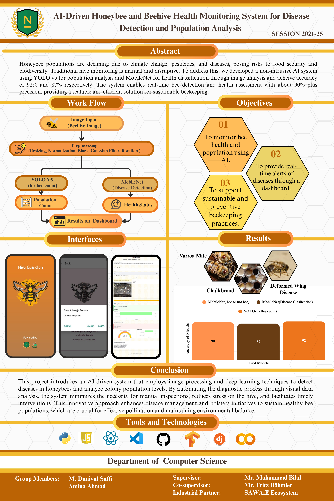

# AI-Driven Honeybee and Beehive Health Monitoring System

Final Year Project — BS Computer Science, Namal University Mianwali (2021–2025)

An AI system for honeybee disease detection and beehive population analysis, built with SAWiE Ecosystem, Germany. The system uses deep learning models — CNN, ResNet, MobileNet and YOLOv8 — to detect disease and monitor colony health from hive imagery, with field validation at HBRI and NARC, Islamabad.

## Results (from the final year project report)
- MobileNet: 87% accuracy in disease classification
- YOLOv8: 92% accuracy in disease detection and localization
- Diseases covered: Varroa Mite, Chalkbrood and Deformed Wing Disease
- Results are presented through a mobile app (Hive Guardian) and a dashboard

## Recognition
- 1st position — AgriFusion 2025
- 4th of 250+ entries from 54 universities — Innovative Lyallpur 3.0

## Project team
- Amina Ahmad (NIM-BSCS-2021-27)
- Muhammad Daniyal Saffi (NIM-BSCS-2021-31)
- Supervisor: Mr. Muhammad Bilal
- Co-supervisor: Mr. Fritz Böhmler
- Industrial Partner: SAWiE Ecosystem, Germany
- Department of Computer Science, Namal University Mianwali, Pakistan

## Poster
The project poster from the university showcase is in this repository. It shows the earlier build, which used YOLO v5; the final report uses YOLOv8.

## Verification
Namal University's Career Development Center lists this project here:
https://cdc.namal.edu.pk/projectDetails/ai-driven-honeybee-and-beehive-health-monitoring-system-for-disease-detection-and-population-analysis

## Report
The complete final year project report (129 pages) is in this repository:
[Final_Year_Project_Report.pdf](Final_Year_Project_Report.pdf)

## Contact
Muhammad Daniyal Saffi
- LinkedIn: https://www.linkedin.com/in/muhammad-daniyal-saffi-91320322a
- Email: daniyals0316@gmail.com
